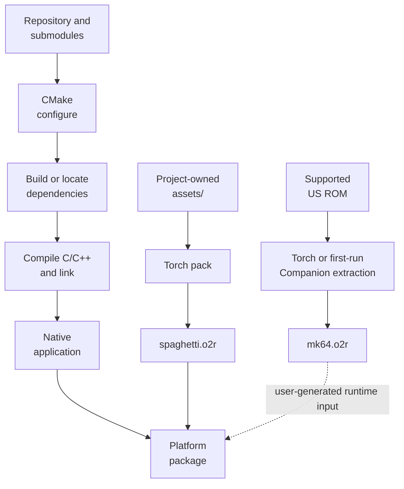
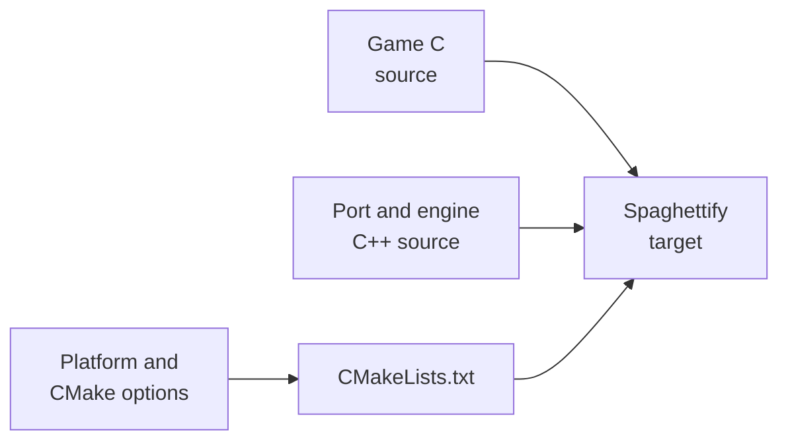
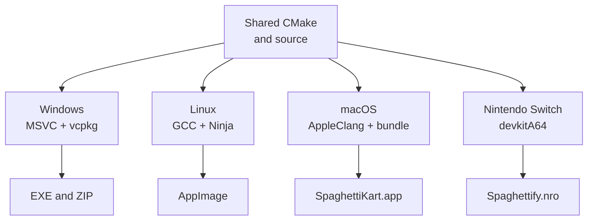

# SpaghettiKart build process

## Contents

- [End-to-end overview](#end-to-end-overview)
- [Concepts](#concepts)
- [Build stages](#build-stages)
- [1. Configure](#1-configure)
- [2. Build dependencies](#2-build-dependencies)
- [3. Compile the application](#3-compile-the-application)
- [4. Generate resource archives](#4-generate-resource-archives)
- [5. Package](#5-package)
- [Platform branches](#platform-branches)
- [Continuous integration](#continuous-integration)

Architecture path: [Overview](Overview.md) → **Build**

## End-to-end overview

The application build does not compile code out of the ROM. The ROM supplies
assets for `mk64.o2r`; game logic already exists as C/C++ source in the tree.

## Concepts

- [CMake](../../CMakeLists.txt) — coordinates the `Spaghettify` executable,
  dependencies, asset targets, runtime staging, and platform packaging.

- [libultraship](https://github.com/Kenix3/libultraship) — native framework for
  configuration, windows, controllers, archives, resources, audio output, and
  the Fast3D graphics path. It is pinned as a Git submodule.

- [Torch](https://github.com/HarbourMasters/Torch) — asset extraction and
  packaging tool. This project enables its Mario Kart 64 and NAudio loaders.

- **O2R archive** — resource archive consumed by libultraship. `mk64.o2r`
  contains data extracted from the player's ROM; `spaghetti.o2r` contains
  project-owned resources from `assets/`.

- **Reconstructed game source** — C source corresponding to Mario Kart 64 game
  logic. It is compiled together with handwritten port and custom-engine code;
  there is no runtime CPU translation boundary.

## Build stages

| Stage | Intention | Main implementation | Result | Artifact |
| --- | --- | --- | --- | --- |
| Configure | Select platform, compiler, dependencies, and build type. | [Root CMake project](../../CMakeLists.txt), [CMake variables](../../cmake/SetCmakeVar.cmake) | Generated native build graph | Build directory chosen with `-B` |
| Dependencies | Make the platform framework and asset tools available. | [Common dependencies](../../cmake/dependencies/common.cmake), Git submodules | libultraship, Torch, and third-party libraries | Targets inside the build directory |
| Compile | Produce one native program from game and port source. | [Source collection and executable](../../CMakeLists.txt), [compiler flags](../../cmake/SetFlags.cmake) | Linked `Spaghettify` application | Platform executable or app bundle |
| Generate resources | Convert project assets and, privately, ROM assets into runtime archives. | [`GenerateO2R.cmake`](../../cmake/GenerateO2R.cmake), `ExtractAssets` target | `spaghetti.o2r` and optional private `mk64.o2r` | Build directory and runtime package |
| Package | Stage configuration, metadata, executable, and public resources. | [Packaging configuration](../../cmake/packaging.cmake), [runtime staging](../../cmake/StageRuntimeFiles.cmake) | Platform deliverable | AppImage, ZIP, app bundle, or NRO |

## 1. Configure

CMake collects the reconstructed C files, C++ engine and port files, courses,
enhancements, and platform resources into one executable target. It also sets
the US game version and enables non-matching/non-equivalent port adaptations.

References: [source globs](../../CMakeLists.txt),
[target definitions](../../cmake/SetFlags.cmake), and
[manual commands](../BUILDING.md).

## 2. Build dependencies

The repository pins libultraship and Torch as submodules. CMake adds both to
the build; Torch is also configured as a standalone external tool for asset
targets. Platform libraries such as SDL, OpenGL, Ogg, and Vorbis are resolved
from vcpkg, the SDK, or the host system.

| Dependency | Build role | Runtime role | Reference |
| --- | --- | --- | --- |
| libultraship | Linked into the executable | Window, input, configuration, resources, audio output, Fast3D | [dependency setup](../../cmake/dependencies/common.cmake) |
| Torch | Library plus standalone asset tool | Its Companion path performs first-run ROM extraction | [CMake integration](../../CMakeLists.txt) |
| SDL and platform SDKs | Native headers and libraries | Window, input, dialogs, and platform integration | [library resolution](../../cmake/dependencies/FindLib.cmake) |
| Ogg/Vorbis and native audio dependencies | Audio codecs and linking | Decoded custom or extracted audio reaches the native mixer | [library resolution](../../cmake/dependencies/FindLib.cmake) |

## 3. Compile the application

The compiler builds the original/reconstructed C, platform shims, and custom
C++ engine into a single address space. The final link adds libultraship,
Torch, and platform libraries. Release builds use the optimization flags in
[`SetFlags.cmake`](../../cmake/SetFlags.cmake); exact compilers differ by target.

This stage produces code only. Copyrighted game assets remain outside the
repository and are created from the player's ROM as `mk64.o2r`.

## 4. Generate resource archives

The build exposes two related targets:

| Target | Input | Output | Use |
| --- | --- | --- | --- |
| `GenerateO2R` | Repository `assets/` | `spaghetti.o2r` | Packs project-owned fonts, shaders, tracks, textures, and metadata. |
| `ExtractAssets` | Supported `baserom.us.z64` plus `assets/` | `mk64.o2r` and `spaghetti.o2r` | Developer convenience for generating both archives locally. |

CI generates only `spaghetti.o2r` from repository-owned content and shares it
with platform jobs. A player generates `mk64.o2r` from their own ROM at runtime
when it is absent. See [Resources](Resources.md).

## 5. Package

Packaging stages the executable, `spaghetti.o2r`, and runtime metadata. Linux
uses CPack's external generator and linuxdeploy; Windows uses ZIP artifacts;
macOS builds a signed application bundle; Nintendo Switch emits an NRO.

The private `mk64.o2r` is not a repository artifact. It is generated by each
user and located through libultraship's application directories.

## Platform branches

| Target | Toolchain and graphics surface | Package path |
| --- | --- | --- |
| Windows x64/Win32 | Visual Studio 2022; Direct3D 11 or OpenGL via Fast3D | `Spaghettify.exe` in ZIP |
| Linux x86_64/x86 | GCC/Ninja in host or Ubuntu container; OpenGL/OpenGL ES | AppImage |
| macOS arm64/Intel | AppleClang/Ninja; Metal or OpenGL | `SpaghettiKart.app` ZIP |
| Nintendo Switch | devkitA64 toolchain and platform libultraship branch | `Spaghettify.nro` plus `spaghetti.o2r` |

The root CMake file also contains iOS support, but the principal build workflow
currently publishes the four target families above.

## Continuous integration

[`main.yml`](../../.github/workflows/main.yml) first creates the public
`spaghetti.o2r` artifact. Windows, Linux, macOS, and Switch jobs then compile
the same source and insert that archive into their packages.

Pull-request workflows independently validate
[Linux](../../.github/workflows/linux-compile.yml),
[Windows](../../.github/workflows/windows-compile.yml), and
[macOS](../../.github/workflows/macos-compile.yml). Linux additionally exercises
containerized x86_64 and x86 paths.
