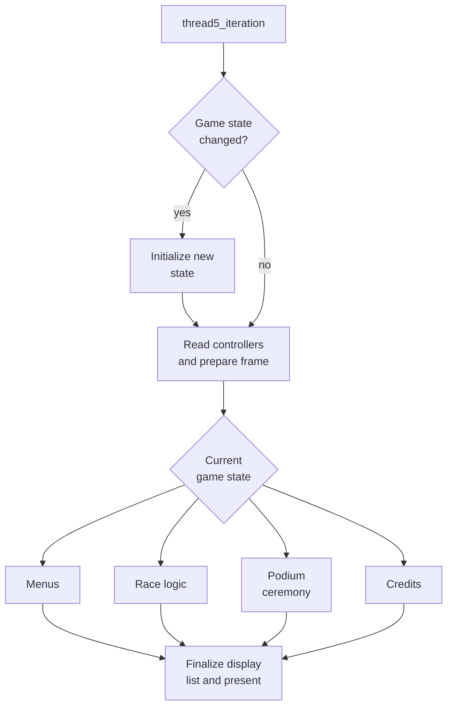
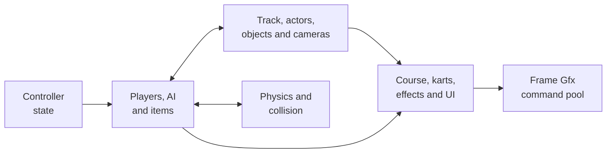
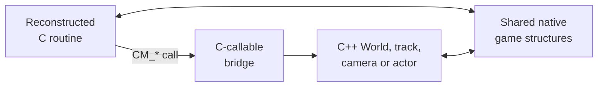

# Game code and custom engine

## Contents

- [Responsibility](#responsibility)
- [Ownership split](#ownership-split)
- [Game-state machine](#game-state-machine)
- [Racing frame](#racing-frame)
- [C and C++ integration](#c-and-c-integration)
- [World and content model](#world-and-content-model)
- [Concrete race example](#concrete-race-example)
- [Lifecycle and invariants](#lifecycle-and-invariants)

Architecture path: [Overview](Overview.md) → [Runtime](Runtime.md) → **Game code and custom engine**

## Responsibility

Game code owns Mario Kart's simulation: menus, race state, players, AI,
physics, collision, cameras, actors, items, effects, and construction of N64
graphics commands. SpaghettiKart compiles reconstructed C and handwritten C++
extensions into the same native executable.

There is no guest CPU or separately loaded game module. The distinction below
describes code ownership and data models inside one address space.

## Ownership split

| Area | Reconstructed C | Custom C++ engine | Integration |
| --- | --- | --- | --- |
| Main state machine | Menus, racing, ending, credits | Intro and editor additions | [`game_state_handler`](../../src/main.c), [`Game.cpp`](../../src/port/Game.cpp) |
| Race simulation | Players, AI, items, collisions, lap logic | `RaceManager`, custom tracks and actors | [`src/racing/`](../../src/racing), [`RaceManager.cpp`](../../src/engine/RaceManager.cpp) |
| World content | Original arrays and global state | Owned tracks, cameras, actors, objects, particles, cups | [`World.h`](../../src/engine/World.h) |
| Rendering | Emits original-style `Gfx` commands | Adds tracks, sky, actors, editor and cameras to the same command pool | [`CM_DrawTrack`](../../src/port/Game.cpp), [Graphics](Graphics.md) |
| Data | Native globals and C structs | C++ objects, registries, smart pointers | [`Game.h`](../../src/port/Game.h) exposes the bridge |

## Game-state machine

`thread5_iteration()` performs one simulation/render iteration. It applies a
pending state transition, reads controllers, configures the graphics pool, and
dispatches to the current persistent game state.

The state does not alternate every frame. It remains active until game logic
sets `gGamestateNext`, at which point the following iteration runs the new
state's initialization.

References: [`thread5_iteration`](../../src/main.c),
[`update_gamestate`](../../src/main.c), and
[`game_state_handler`](../../src/main.c).

## Racing frame

The racing branch updates gameplay and emits rendering work into the shared
graphics pool. Its exact internal call graph varies by mode, player count, and
course, but the component flow is stable.

The native host does not decide who wins a race or how a kart accelerates.
Those decisions remain in game-owned code. Host services supply inputs,
resources, timing, audio output, and graphics presentation.

## C and C++ integration

[`Game.h`](../../src/port/Game.h) declares C-callable `CM_*`, `HM_*`, and
graphics functions implemented in C++. Reconstructed C invokes those functions
directly; C++ code includes C headers and reads or updates compatible game
structures directly.

This is an ordinary native ABI boundary, not serialization or inter-process
communication. It therefore requires layout and lifetime discipline. For
example, [`World.cpp`](../../src/engine/World.cpp) deliberately converts
between an `AActor` C++ object and the compatible C `Actor` subobject located
after its vtable pointer.

## World and content model

`World` is the custom engine's owner for content that does not fit the retained
global arrays. It owns the active track, race manager, cameras, custom actors,
objects, static meshes, particles, cups, Lakitu instances, and crossings.

| Component | Stored state | Main operations |
| --- | --- | --- |
| `World` | Active track and owned gameplay objects | Add, tick, draw, reset and clean content |
| `RaceManager` | Race-specific custom systems | Load, initialize, and coordinate extended race content |
| Track registry | Built-in and mod track descriptors | Select and instantiate a track by identifier |
| Actor/item registries | Factories and metadata | Spawn registered native content |
| Cameras | Active and pending camera objects | Tick, attach, switch, and emit view matrices |
| Editor | Scene objects and editing state | Inspect and modify custom content at runtime |

Startup registers tracks, actors, items, item tables, and cups in
[`CustomEngineInit`](../../src/port/Game.cpp). Course transitions then select
and load the applicable `Track` through the world and race manager.

## Concrete race example

When the player steers through a custom course:

1. libultraship maps the native controller to N64-shaped pad state.
2. `read_controllers()` publishes buttons and sticks to the game controllers.
3. race logic updates the player, AI, physics, items, and lap state.
4. `World` ticks custom track objects, actors, particles, and cameras at the
   integration points called by the reconstructed C loop.
5. both code families append commands to the same `Gfx` pool.
6. Fast3D presents the resulting frame; the next iteration observes the
   updated shared state.

References: [controller publication](../../src/main.c),
[`World` operations](../../src/engine/World.cpp), and
[graphics submission](Graphics.md#frame-command-path).

## Lifecycle and invariants

- Game globals and `World` content are shared native state; neither is a copy
  of the other.
- `CM_*` bridges must preserve C-compatible types and object lifetimes.
- Original C actors and custom C++ actors have different ownership paths;
  `World::TickActors` deliberately ticks only modded actors.
- World cleanup must run while dependent singletons still exist. Startup error
  and final shutdown paths use `_Exit` to avoid unsafe static destruction.
- Frame interpolation may replay rendering matrices, but it does not execute a
  second gameplay update.
