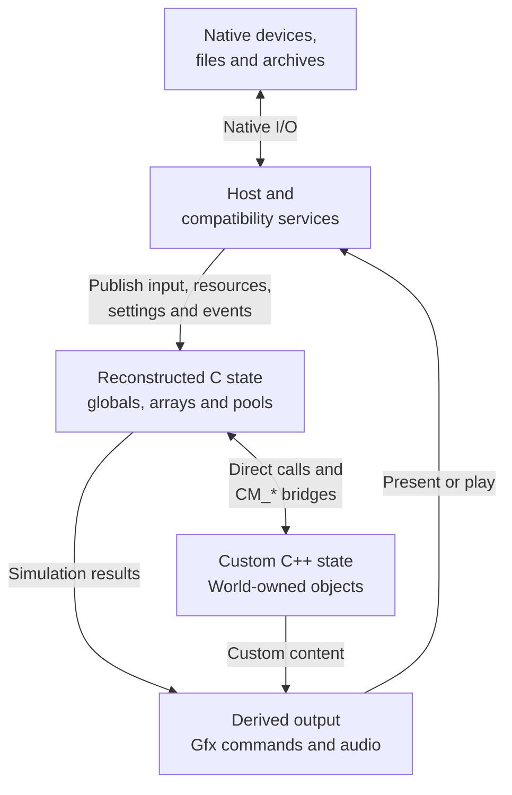
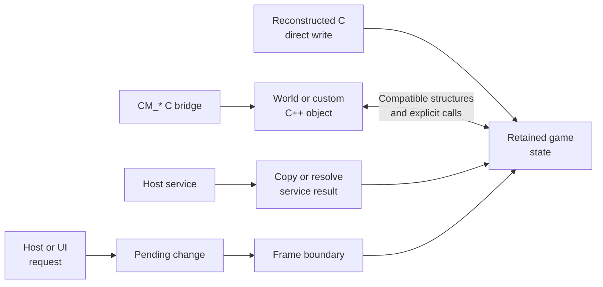
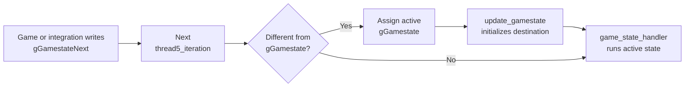
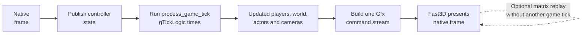

# Game state and mutation

## Contents

- [Purpose and model](#purpose-and-model)
- [Ownership map](#ownership-map)
- [State stores](#state-stores)
- [Mutation mechanics](#mutation-mechanics)
- [State transitions](#state-transitions)
- [Simulation and presentation](#simulation-and-presentation)
- [Service publication](#service-publication)
- [Concurrency and lifetime](#concurrency-and-lifetime)
- [Concrete examples](#concrete-examples)
- [Invariants](#invariants)

Architecture path: [Overview](Overview.md) → [Runtime](Runtime.md) → **Game state and mutation**

## Purpose and model

Game state is the native data that describes the current menu, race, players,
world, cameras, actors, and other simulation results. SpaghettiKart does not
have a guest CPU, guest address space, or separately loaded game module.
Reconstructed C, custom game-side C++, and host integrations are linked into
one process and can operate on ordinary native objects and pointers.

The distinction is therefore ownership rather than isolation:

| Code family | Primary responsibility | Relationship to game state |
| --- | --- | --- |
| Reconstructed game C | Original menus, race rules, players, AI, physics, actors, cameras, and display-list construction | Owns and directly updates most retained globals, arrays, and structures |
| Custom game-side C++ | Tracks, actors, objects, editor, cameras, particles, and project enhancements | Owns `World` objects and integrates them with retained state through `CM_*` bridges |
| Native host | Process, libultraship context, window, resources, input mappings, UI, audio output, and lifecycle | Publishes service results and coordinates safe execution boundaries; it does not own race rules |
| Compatibility services | Controller, timing, message, storage, audio, and resource adapters | Convert native facilities into values, buffers, pointers, or events consumed by game code |

## Ownership map

These arrows show responsibility and data flow, not memory protection. The
host or custom engine may access game globals where an explicit integration
requires it, but the normal contract is to publish a service result and let
game-owned code decide how it changes gameplay.

## State stores

| Store | Examples | Owner and lifetime | Source |
| --- | --- | --- | --- |
| Retained globals and arrays | `gGamestate`, `gGamestateNext`, `gPlayers`, `gControllers`, `gGfxPools` | Reconstructed game; process or game-session lifetime | [`main.c`](../../src/main.c) |
| Retained memory pools | Graphics pools, matrices, actors, course and race data | Game code; reset or frame scoped depending on the pool | [`setup_game_memory`](../../src/main.c), [`race_logic_loop`](../../src/main.c) |
| Custom world | Track, race manager, cameras, custom actors, objects, meshes and particles | `World`; explicit load, cleanup, and replacement | [`World.h`](../../src/engine/World.h) |
| Host/service state | CVars, controller mappings, archives, window, UI and audio output | libultraship context and `GameEngine` | [Native host](Host.md) |
| Resource backing data | Typed resources and raw data returned from O2R archives | Resource manager; game code receives borrowed native pointers | [Resources](Resources.md), [`GBIMiddleware.cpp`](../../src/port/GBIMiddleware.cpp) |
| Persistent state | Configuration and Controller Pak files | Host filesystem; loaded or written through adapters | [Platform services](Services.md#persistent-storage) |

Host configuration is not automatically gameplay state. A CVar becomes
game-relevant only when game or integration code reads it and changes a branch
or parameter. Likewise, a resource pointer identifies backing data; resolving
it does not replace every game pointer or create a second memory model.

## Mutation mechanics

### Direct native mutation

Reconstructed routines read and write C objects directly. For example,
`update_controller()` copies a pad sample into `gControllers[index]` and
derives pressed, released, and directional fields. There is no address
translation or guest-memory helper between the routine and that structure.

### C and C++ bridge mutation

[`Game.h`](../../src/port/Game.h) exposes C-callable `CM_*` functions. The
retained loop invokes them to tick custom cameras, actors, tracks, and editor
systems. C++ code can also include C declarations and operate on compatible
structures. This makes layout, ownership, and lifetime part of the contract;
it is not serialization or inter-process communication.

### Service publication

Services first convert native state into a form expected by the game. Input,
for example, moves from libultraship mappings to `OSContPad`, then into the
game-owned `Controller` structures. Resource middleware resolves an O2R
signature to a manager-owned native pointer before the game or graphics path
uses the data.

### Deferred mutation

Changes that would race an in-progress state transition are requested first
and applied at a defined boundary. `CM_RequestReset()` sets an atomic pending
flag; `ApplyPendingReset()` consumes it at the beginning of `push_frame()` and
updates the menu, race, audio, editor, and transition fields together.

## State transitions

`gGamestate` is the active state. `gGamestateNext` is a requested state, not a
second active simulation. The next `thread5_iteration()` commits the request
and initializes the destination before dispatching its handler.

This queued transition prevents a half-initialized menu or race from becoming
active during the current handler. The reset integration uses the same
protocol rather than bypassing it.

References: [`thread5_iteration`](../../src/main.c),
[`update_gamestate`](../../src/main.c), and
[`ApplyPendingReset`](../../src/port/Game.cpp).

## Simulation and presentation

Game state advances in `process_game_tick()`. A racing iteration may run it
`gTickLogic` times before constructing one frame. Rendering then reads the
resulting state and appends commands to the current `Gfx` pool.

Frame interpolation records and replays presentation matrices. It does not
run the simulation again or maintain an independent copy of the world.

References: [`process_game_tick`](../../src/main.c),
[`race_logic_loop`](../../src/main.c), and [Graphics](Graphics.md).

## Service publication

| Service | Native or host-side state | Publication into game behavior |
| --- | --- | --- |
| Input | Keyboard or SDL controller mappings in `ControlDeck` | `osContGetReadData()` fills pad samples; `read_controllers()` copies and derives game controller fields |
| Resources | O2R archive entries owned by the resource manager | Middleware resolves signatures to typed objects or borrowed raw pointers |
| Configuration | Persistent CVars | Game, host, or custom systems read a value at an explicit decision point |
| Audio | Retained audio state plus HMAS sources | Worker produces a complete mixed buffer; frame coordination waits for publication before continuing |
| Storage | Native files in the application data directory | `osPfs*` adapters read or write durable Controller Pak records |
| Graphics | Native `Gfx` pool built from current simulation state | Fast3D consumes commands; GPU work does not mutate the race simulation |

See [Platform services](Services.md) for the adapter implementations.

## Concurrency and lifetime

Most live simulation state is advanced by the retained game loop. This does
not make every native object generally thread-safe. Cross-thread work uses
specific publication points:

- reset requests use an atomic flag and are applied on the game frame;
- the audio worker uses a mutex and condition variables, then completes before
  `EndAudioFrame()` returns;
- resource pointers remain valid according to resource-manager ownership;
- `World` cleanup and host shutdown are ordered so dependent singletons and
  borrowed objects still exist.

Code that introduces another worker must define which inputs remain stable,
which outputs it owns, and where completion becomes visible to the game loop.

## Concrete examples

### Steering a kart

1. libultraship samples a native device through the configured mapping.
2. the controller compatibility path fills `gControllerPads`.
3. `read_controllers()` updates `gControllers`, including edge-triggered
   pressed and released fields;
4. `process_game_tick()` and player-controller routines read those fields and
   update player and race structures;
5. rendering reads the updated state and emits the kart's graphics commands.

### Resetting to the menu

1. UI code calls `CM_RequestReset()` without rewriting the active state;
2. `push_frame()` calls `ApplyPendingReset()` before starting the next game
   iteration;
3. the function resets coordinated menu, pause, audio, editor, and track
   fields and requests a new `gGamestateNext`;
4. `thread5_iteration()` commits and initializes that state through the normal
   transition path.

### Drawing an archive-backed mesh

1. game or custom code places an O2R signature in a display-list command;
2. [`GBIMiddleware.cpp`](../../src/port/GBIMiddleware.cpp) asks the resource
   manager for the referenced object;
3. middleware passes the resource's native display-list, vertex, or raw-data
   pointer to Fast3D;
4. the resource manager retains ownership while the command is consumed.

## Invariants

- “Original game code” identifies reconstructed source and behavior, not code
  executing inside an emulated guest.
- “Host” identifies platform and lifecycle ownership, not all handwritten C++.
  `World` and its gameplay systems are custom game-side code.
- Shared address space permits direct access, but an explicit bridge or
  ownership rule should still define each cross-component mutation.
- Resolving a resource changes a reference into usable backing data; it does
  not translate a guest address.
- Rendering and interpolation consume game state; they do not advance it.
- Persistent files, host configuration, and live race state are separate even
  when one is used to initialize or influence another.
