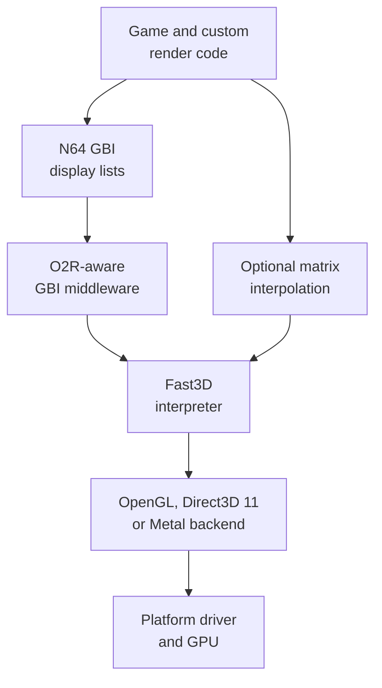
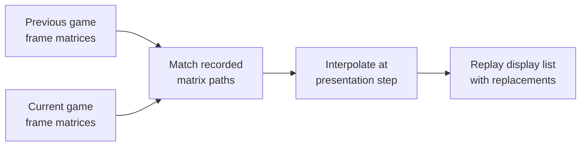

# Graphics stack

## Contents

- [Stack overview](#stack-overview)
- [Component responsibilities](#component-responsibilities)
- [Frame command path](#frame-command-path)
- [Resource resolution](#resource-resolution)
- [Frame interpolation](#frame-interpolation)
- [Platform backends](#platform-backends)
- [Concrete rendering example](#concrete-rendering-example)

Architecture path: [Overview](Overview.md) → [Runtime](Runtime.md) → **Graphics stack**

## Stack overview



SpaghettiKart preserves the N64 graphics command vocabulary but does not send
those commands to emulated RSP/RDP hardware. Native Fast3D code interprets the
display lists and issues modern graphics API work.

## Component responsibilities

| Layer | Responsibility | Reference |
| --- | --- | --- |
| Game render code | Chooses visible courses, karts, actors, effects, UI, and emits `Gfx` commands. | [`src/racing/`](../../src/racing), [`src/engine/`](../../src/engine) |
| GBI middleware | Resolves O2R-backed display lists, vertices, textures, and invalidation addresses. | [`GBIMiddleware.cpp`](../../src/port/GBIMiddleware.cpp) |
| Frame interpolation | Records matrix operations and derives intermediate matrices between game updates. | [`FrameInterpolation.cpp`](../../src/port/interpolation/FrameInterpolation.cpp) |
| `GameEngine` graphics bridge | Handles events, chooses interpolation frames, and submits command streams. | [`ProcessGfxCommands`](../../src/port/Engine.cpp) |
| Fast3D/libultraship | Interprets N64 commands, manages GPU resources, and presents through a backend. | [libultraship](https://github.com/Kenix3/libultraship) |
| Platform backend | Converts normalized rendering work to the host graphics API. | Backend selection in [`SpaghettiGui.cpp`](../../src/port/SpaghettiGui.cpp) and libultraship |

## Frame command path

The retained game loop configures a graphics pool, renders the current game
state into that pool, closes the master display list, and submits it through
`Graphics_PushFrame`. The bridge forwards the pool to
`GameEngine::ProcessGfxCommands`.

```mermaid
sequenceDiagram
    participant Loop as Game loop
    participant Pool as Gfx pool
    participant Bridge as GameEngine
    participant Fast3D as Fast3D
    participant GPU as Native GPU API

    Loop->>Pool: Emit course, kart, actor and UI commands
    Loop->>Pool: End display list and full sync
    Loop->>Bridge: Graphics_PushFrame(pool)
    Bridge->>Fast3D: Draw commands with matrix replacements
    Fast3D->>GPU: Create/update resources and issue draws
    GPU-->>Fast3D: Present completed frame
```

References: [`thread5_iteration`](../../src/main.c),
[`Graphics_PushFrame`](../../src/port/Game.cpp), and
[`GameEngine::RunCommands`](../../src/port/Engine.cpp).

## Resource resolution

Display lists can contain direct native pointers or O2R path references. The
middleware checks the signature and replaces a resource path with the loaded
display-list instruction array, vertex array, or raw resource pointer before
forwarding the command to Fast3D.

This boundary lets the same draw code consume base ROM assets, project assets,
or a higher-priority mod replacement. See [Resources](Resources.md).

## Frame interpolation

Gameplay normally advances at the original update cadence. Interpolation
records transformation operations and identifies matching matrices across
adjacent game frames. For each requested intermediate presentation, it creates
a matrix-replacement map and replays the same display list with those matrices.



Interpolation changes presentation, not game simulation frequency. Camera cuts
and unmatched paths are tracked so unsafe matrix pairs are not blindly blended.

References: [interpolation design and recording](../../src/port/interpolation/FrameInterpolation.cpp)
and [submission loop](../../src/port/Engine.cpp).

## Platform backends

| Platform | Primary native backend | Alternative shown by project configuration |
| --- | --- | --- |
| Windows | Direct3D 11 | OpenGL |
| Linux | OpenGL | OpenGL ES when `USE_OPENGLES` is enabled |
| macOS | Metal | OpenGL where supported by the framework/build |
| Nintendo Switch | Platform libultraship/Fast3D backend | Target-specific |

The backend changes below the Fast3D interpreter. Game render code continues to
emit the same N64 display-list commands across platforms.

## Concrete rendering example

Rendering a kart on a course crosses the stack as follows:

1. The current race state selects camera, kart, course section, actors, and UI.
2. Render routines append matrix, vertex, texture, combiner, and triangle
   commands to the frame's `Gfx` pool.
3. O2R middleware resolves referenced display lists and resource data.
4. Interpolation may provide replacement matrices for extra presentation frames.
5. Fast3D interprets the commands, manages native textures/buffers/pipelines,
   and sends draws through the active backend.
6. The native window presents the final frame; game simulation advances only
   on its next normal iteration.

This separation explains why a mod can replace a texture or model without
changing race logic, and why a backend change need not alter game-owned draw
code.
