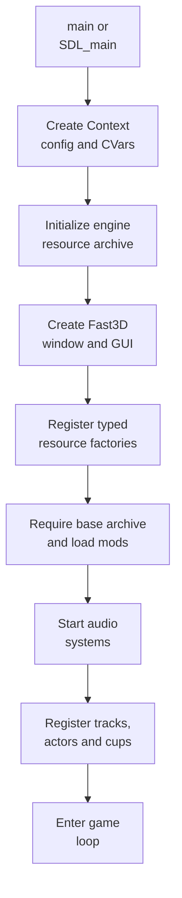
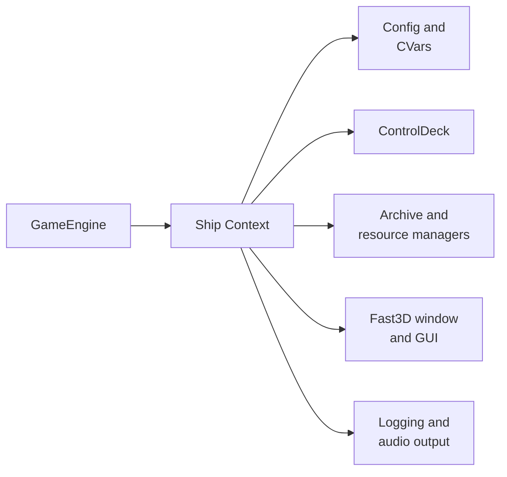
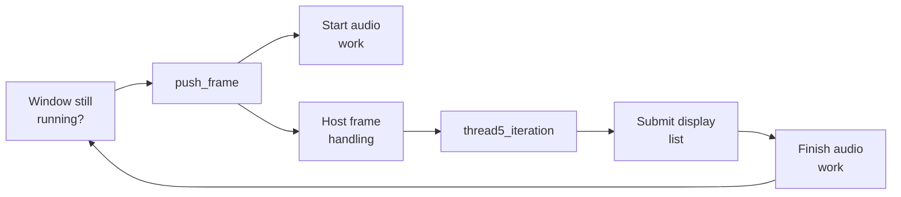

# Native host and port layer

## Contents

- [Responsibility](#responsibility)
- [Owned components](#owned-components)
- [Initialization phases](#initialization-phases)
- [Context assembly](#context-assembly)
- [Game-facing bridges](#game-facing-bridges)
- [Frame coordination](#frame-coordination)
- [Configuration and UI](#configuration-and-ui)
- [Lifecycle constraints](#lifecycle-constraints)

Architecture path: [Overview](Overview.md) → [Runtime](Runtime.md) → **Native host and port layer**

## Responsibility

The native host enters the process and connects game code to platform
facilities. `GameEngine` specializes libultraship for SpaghettiKart; it does
not own race rules or simulate an N64 CPU.

## Owned components

| Component | Responsibility | Source |
| --- | --- | --- |
| Process entry | Platform setup, component creation, main loop, ordered shutdown | [`Game.cpp`](../../src/port/Game.cpp) |
| `GameEngine` | Context, mappings, resource factories, graphics bridge, audio worker | [`Engine.cpp`](../../src/port/Engine.cpp) |
| libultraship `Context` | Configuration, CVars, controllers, archives, resources, window, GUI, logging and audio output | [libultraship](https://github.com/Kenix3/libultraship) |
| `SpaghettiGui` and port UI | Game window composition, menus, editor tools and settings | [`SpaghettiGui.cpp`](../../src/port/SpaghettiGui.cpp), [`src/port/ui/`](../../src/port/ui) |
| Game extractor | ROM selection, validation and first-run O2R creation | [`GameExtractor.cpp`](../../src/port/GameExtractor.cpp) |
| C bridges | Stable functions callable from reconstructed C | [`Engine.h`](../../src/port/Engine.h), [`Game.h`](../../src/port/Game.h) |

## Initialization phases

The order is deliberate because later components consume earlier services.

`InitConfiguration()` precedes console variables; the initial resource manager
precedes GUI/window initialization; typed factories are registered before game
resources are requested. These dependencies are called out directly in
[`GameEngine::GameEngine`](../../src/port/Engine.cpp).

## Context assembly

The host creates a `Ship::Context` named `Spaghetti Kart` with
`spaghettify.cfg.json`. It supplies:

- a `ControlDeck` with project-specific N64 button names and default keyboard
  and SDL mappings;
- a `Fast3dWindow` with `SpaghettiGui`;
- the `spaghetti.o2r` engine archive;
- archive/resource managers and project-specific resource factories;
- GUI windows such as input editing and graphics debugging;
- platform logging and audio output owned by libultraship.

## Game-facing bridges

The bridge surface translates ownership, not machine architectures.

| Bridge family | Direction | Purpose |
| --- | --- | --- |
| `GameEngine_*` | C game → host | Audio resources, dimensions, aspect ratio, resource type and interpolation data |
| `ResourceGet*` / `LOAD_ASSET*` | Game → resource manager | Resolve an O2R path into typed or raw native data |
| `Graphics_PushFrame` | Game → host graphics | Submit the completed `Gfx` pool |
| `CM_*` | C game → custom C++ engine | Tracks, actors, cameras, editor, world and race extensions |
| CVars | Both directions | Persist settings and expose enhancements to game and UI code |

Because all components are linked together, bridge calls can pass native
pointers. The API must still keep ownership explicit: archive resources remain
owned by the resource manager, while `World` owns its C++ objects.

## Frame coordination

The outer loop belongs to the native entry point; the simulation iteration
belongs to game code.

`GameEngine::StartFrame` handles host-only shortcuts. Game controller input is
read through the compatibility path inside `thread5_iteration`. Graphics
submission re-enters `GameEngine` when the game finishes its display list.

References: [`push_frame`](../../src/port/Game.cpp),
[`GameEngine::StartFrame`](../../src/port/Engine.cpp), and
[`GameEngine::ProcessGfxCommands`](../../src/port/Engine.cpp).

## Configuration and UI

The port menu maps widgets to CVars. Game and engine code can read the same
values for enhancements such as interpolation, culling, custom engine class,
free camera, AI behavior, and rendering options. `SpaghettiGui` overlays the
game viewport with the settings menu, content browser, scene explorer,
properties, and editor tools.

References: [`PortMenu.cpp`](../../src/port/ui/PortMenu.cpp),
[`Menu.cpp`](../../src/port/ui/Menu.cpp), and
[`SpaghettiGui.cpp`](../../src/port/SpaghettiGui.cpp).

## Lifecycle constraints

The host starts the audio thread only after resources and mods are available.
On normal close it first clears custom game content, then stops audio, unloads
mods, destroys UI and context-owned state, and finally terminates without
running unsafe static destructors.

Early extraction failures also terminate with `_Exit`: the global `World`
object exists, but several singletons its destructor expects have not yet been
created. This is a concrete reason startup and shutdown order are part of the
host contract rather than incidental implementation detail.
