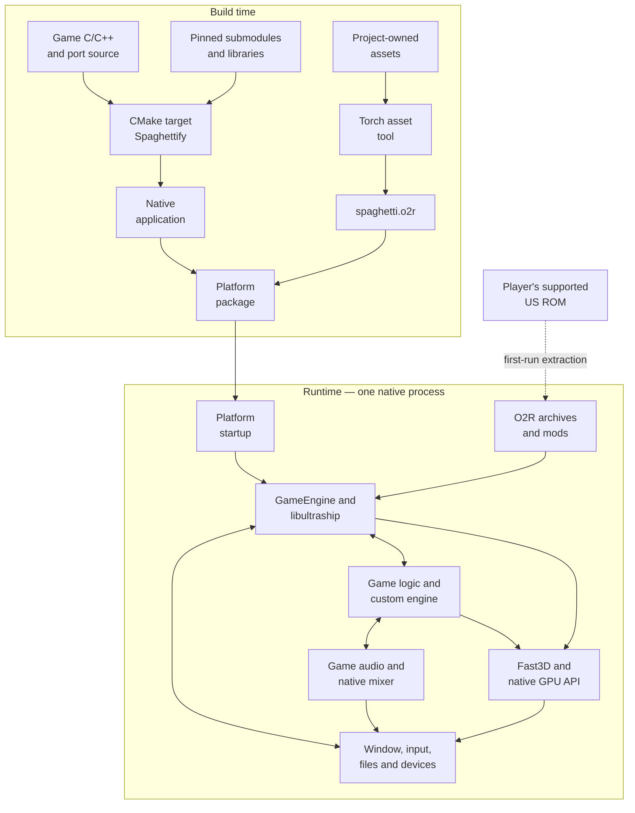
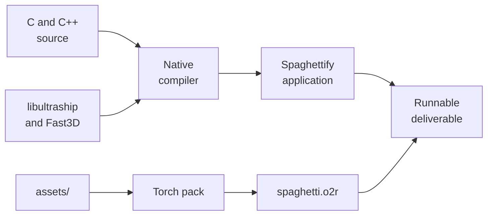
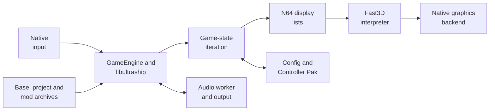

# SpaghettiKart architecture overview

## Contents

- [Introduction](#introduction)
- [High-level view](#high-level-view)
- [Build time](#build-time)
- [Runtime](#runtime)
- [Architecture chapters](#architecture-chapters)

Architecture path: [Index](README.md) → **Overview**

## Introduction

SpaghettiKart is a native port of *Mario Kart 64*. Its executable is compiled
from reconstructed C game code, handwritten C/C++ port code, and native
libraries. It requires a supported US ROM to create the copyrighted
`mk64.o2r` resource archive; those assets are not stored in this repository.

| Approach | Meaning | Relationship to SpaghettiKart |
| --- | --- | --- |
| Conventional emulation | Runs the original N64 executable through an emulated CPU and hardware model. | SpaghettiKart does not run the ROM's original executable through a CPU-emulation loop. |
| Static recompilation | Mechanically translates machine instructions into native-compilable code. | This is not SpaghettiKart's primary execution model. |
| Decompilation | Reconstructs source that represents a compiled program. | The `src/` tree contains reconstructed Mario Kart 64 game code adapted to compile natively. |
| Native reimplementation | Rewrites selected systems for the host platform. | `src/port/`, `src/engine/`, and libultraship supply native startup, resources, graphics, input, audio, persistence, enhancements, and editor features. |

The result is one native program rather than a separate emulated guest
machine. Reconstructed game code and handwritten port code share normal
process memory and call one another through C/C++ interfaces.

## High-level view

The diagram maps ownership and data flow, not an exact call order. `mk64.o2r`
is created from the player's ROM at first run or by the `ExtractAssets` build
target; `spaghetti.o2r` contains project-owned resources.

## Build time

The root [CMake project](../../CMakeLists.txt) compiles reconstructed game code,
the custom engine, platform integration, and the pinned
[libultraship](https://github.com/Kenix3/libultraship) and
[Torch](https://github.com/HarbourMasters/Torch) submodules into the application.
Torch separately packs `assets/` into `spaghetti.o2r`.

See [Build](Build.md) for stages, artifacts, CI, and platform branches.

## Runtime

[`main()`](../../src/port/Game.cpp) creates `GameEngine`, which initializes a
libultraship context, resources, the Fast3D window, controller mappings, audio,
mods, and custom game content. The retained Mario Kart game loop then advances
menus or races and emits N64 display-list commands. Fast3D interprets those
commands for the selected native graphics backend.

See [Runtime](Runtime.md) for startup, frame lifecycle, services, and component
contracts.

## Architecture chapters

| Chapter | Focus |
| --- | --- |
| [Build](Build.md) | Source, dependencies, asset generation, compilation, CI, and packaging |
| [Runtime](Runtime.md) | Process entities, startup, frame loop, audio, input, and persistence |
| [Game code](GameCode.md) | Reconstructed game loop, custom C++ engine, shared state, and C/C++ bridges |
| [Native host](Host.md) | Process entry, `GameEngine`, libultraship context, UI, and lifecycle |
| [Platform services](Services.md) | Input, timing, audio, storage, configuration, and native adaptation |
| [Resources](Resources.md) | ROM validation, O2R generation, resource factories, and mod layering |
| [Graphics](Graphics.md) | Display-list production, interpolation, Fast3D, and platform backends |
