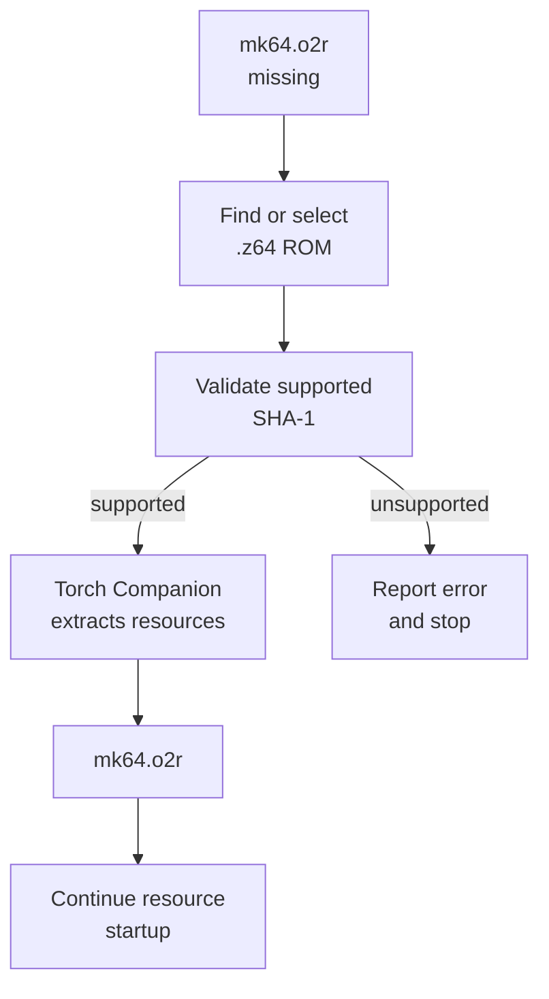
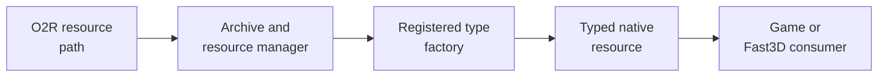
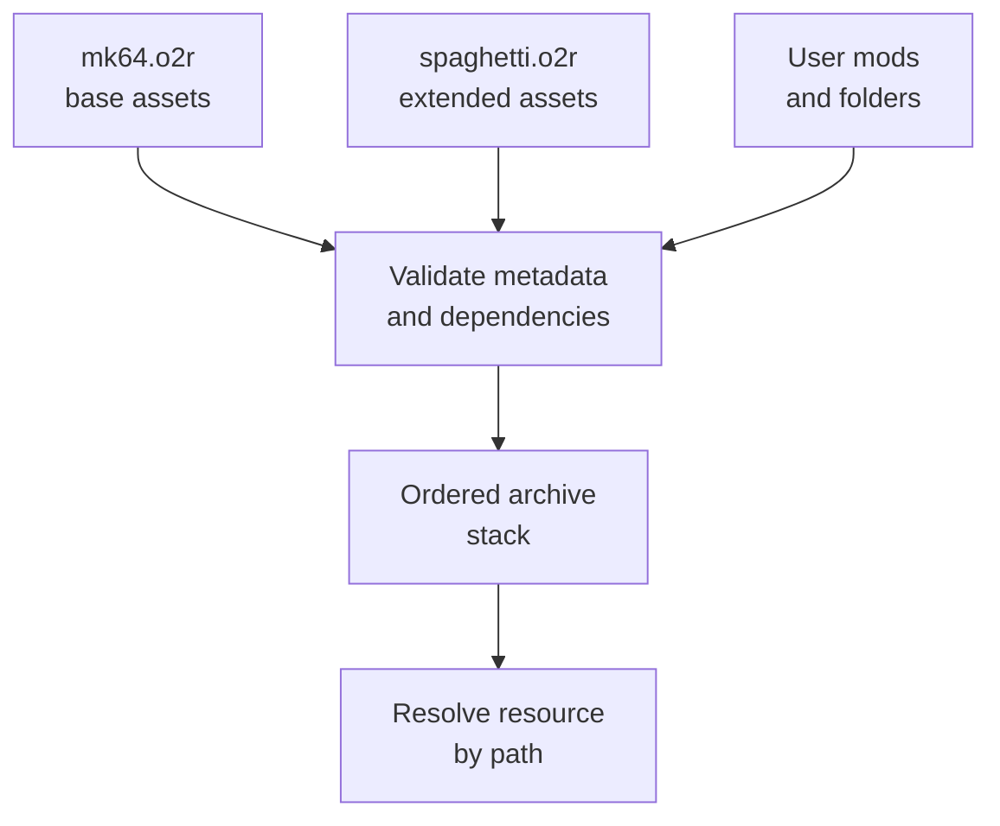

# Resources and mods

## Contents

- [Responsibility](#responsibility)
- [Archive roles](#archive-roles)
- [ROM extraction](#rom-extraction)
- [Resource loading](#resource-loading)
- [Mod layering](#mod-layering)
- [Runtime example](#runtime-example)

Architecture path: [Overview](Overview.md) → [Runtime](Runtime.md) → **Resources and mods**

## Responsibility

The resource system separates native code from copyrighted, project-owned,
and user-modified data. Every source can use the same resource manager while
archive priority decides which concrete asset is returned.

## Archive roles

| Source | Contents | Creation | Runtime location |
| --- | --- | --- | --- |
| `mk64.o2r` | Assets extracted from a supported Mario Kart 64 US ROM | First-run Companion extraction or `ExtractAssets` | User/application data path |
| `spaghetti.o2r` | Project-owned fonts, shaders, tracks, textures, and metadata | Torch packs `assets/` | Shipped beside or inside the application package |
| User mods | Replacements or additions plus `mods.toml` metadata | Created externally | `.o2r`, `.zip`, or folders under `mods/` |

O2R is the active archive format. The build explicitly disables legacy MPQ/OTR
support for the application.

## ROM extraction

[`GameExtractor`](../../src/port/GameExtractor.cpp) finds a `.z64`, validates
the supported ROM, and passes its bytes to Torch's `Companion`. The archive is
generated locally; ROM bytes are not linked into the executable or committed.

## Resource loading

At startup, `GameEngine` registers factories for textures, display lists,
vertices, matrices, lights, audio banks, samples, sequences, course vertices,
track sections, paths, spawn data, minimaps, and generic arrays. A resource
path is then decoded into the corresponding typed native object.

The `__OTR__` signature marks a resource reference. Bridge helpers in
[`Engine.h`](../../src/port/Engine.h) and
[`GBIMiddleware.cpp`](../../src/port/GBIMiddleware.cpp) resolve those references
before game or graphics code dereferences the data.

## Mod layering

[`InitModsSystem`](../../src/engine/mods/ModManager.cpp) requires the base
archive, discovers the engine archive and user mods, reads `mods.toml`, checks
dependency versions and simple cycles, sorts dependencies, and installs the
resulting archive list into libultraship.

Core assets are placed at the bottom of the priority stack. Dependent mods are
ordered after their requirements, allowing a later archive to replace a path
provided by a base archive. Alternate-asset toggling invalidates the graphics
texture cache so replacements become visible.

## Runtime example

When a course draws a textured object:

1. Game or custom-engine code emits a display list containing resource paths.
2. GBI middleware recognizes the O2R signature and asks the resource manager
   for the display list, vertices, or texture.
3. The manager resolves the highest-priority archive entry and invokes its
   registered factory.
4. Fast3D consumes the resulting native object while interpreting the display
   list.

Continue to [Graphics](Graphics.md) for the command path after resolution.
