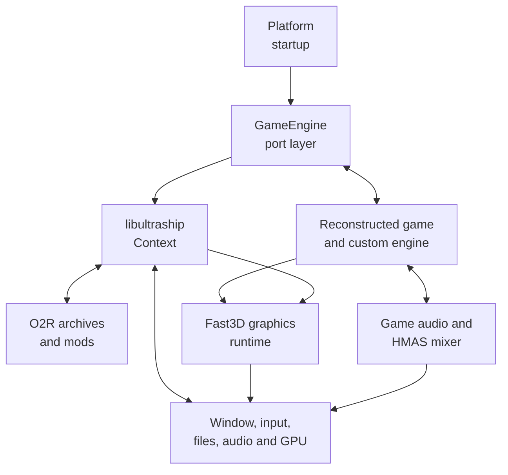
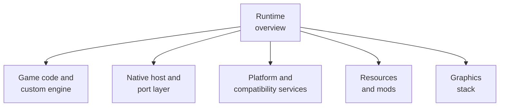
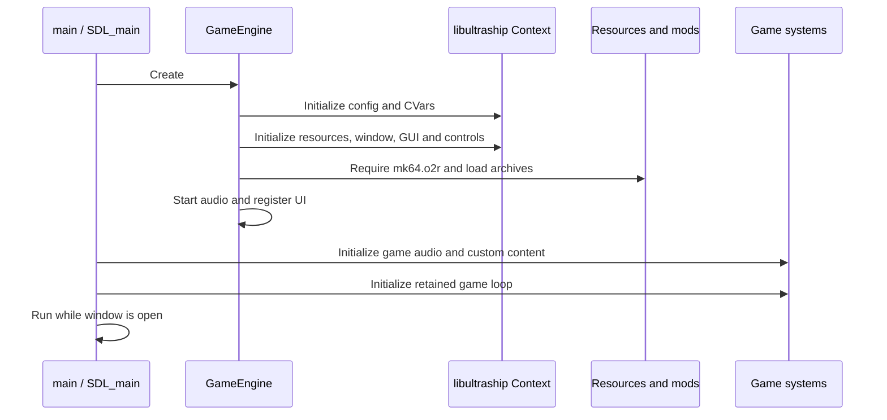
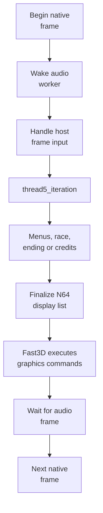
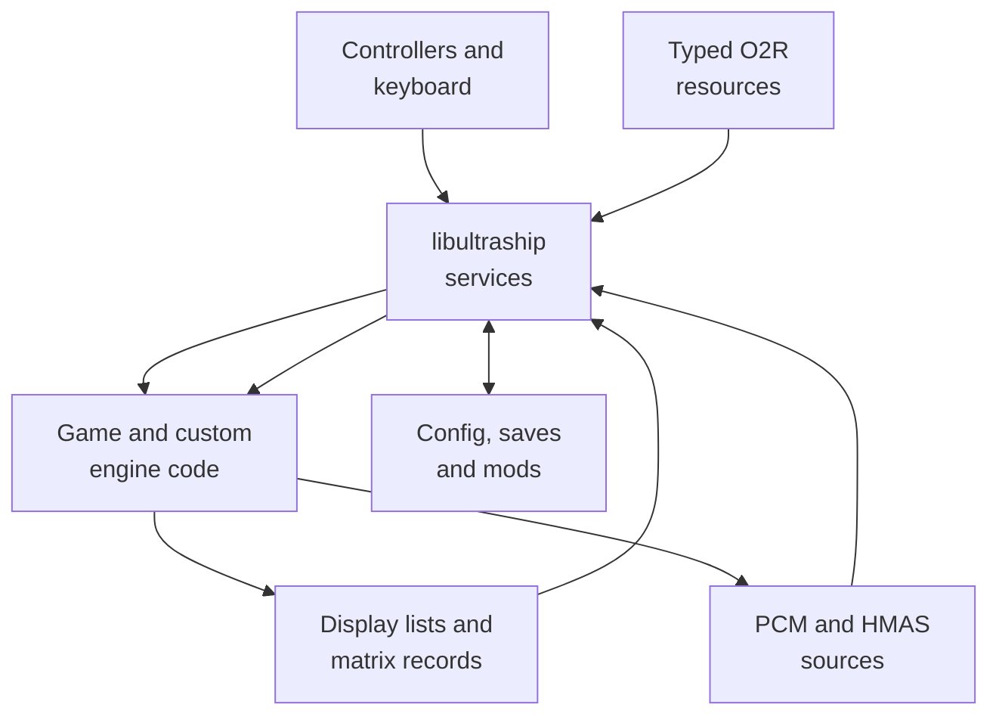
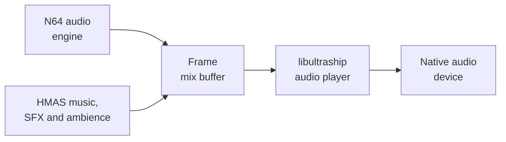

# SpaghettiKart runtime

## Contents

- [High-level view](#high-level-view)
- [Runtime entities](#runtime-entities)
- [Component chapters](#component-chapters)
- [Startup](#startup)
- [Frame lifecycle](#frame-lifecycle)
- [Interaction boundaries](#interaction-boundaries)
- [Input and configuration](#input-and-configuration)
- [Audio](#audio)
- [Persistent data](#persistent-data)
- [Shutdown](#shutdown)

Architecture path: [Overview](Overview.md) → **Runtime**

## High-level view

All boxes run as native code in one process. “Game” identifies ownership and
heritage, not a sandbox or separately loaded module.

## Runtime entities

| Entity | Responsibility | Primary code |
| --- | --- | --- |
| Platform entry | Enters the executable and supplies OS APIs. | [`main()` / `SDL_main()`](../../src/port/Game.cpp) |
| `GameEngine` | Constructs the host context, mappings, resources, graphics window, audio, and UI. | [Native host](Host.md) |
| libultraship context | Owns configuration, controllers, resource/archive managers, window, GUI, and native audio output. | [libultraship project](https://github.com/Kenix3/libultraship) |
| Reconstructed game | Runs menu, race, camera, physics, actor, and display-list logic. | [Game code](GameCode.md) |
| Custom engine | Adds native tracks, actors, editor tools, cameras, registries, and enhancements. | [Game code](GameCode.md#world-and-content-model) |
| Platform services | Adapt input, timing, audio, storage, configuration, files, and dialogs. | [Platform services](Services.md) |
| Resource layer | Resolves base, project, and mod assets into typed native objects. | [Resources](Resources.md) |
| Graphics runtime | Interprets N64 display lists, applies interpolation, and drives a native GPU backend. | [Graphics](Graphics.md) |

## Component chapters

The chapters follow ownership boundaries rather than directories alone.
Reconstructed C and custom C++ are documented together where they jointly own
gameplay; libultraship appears under the host or service that consumes it.

## Startup

If `mk64.o2r` is missing, mod initialization invokes the first-run ROM
selection and extraction flow before normal game startup continues.

References: [`main()`](../../src/port/Game.cpp),
[`GameEngine::GameEngine`](../../src/port/Engine.cpp), and
[`InitModsSystem`](../../src/engine/mods/ModManager.cpp).

## Frame lifecycle

[`push_frame()`](../../src/port/Game.cpp) is the native outer-frame adapter.
It starts audio work, handles host frame input, executes one retained game
iteration, then waits for that frame's audio work to finish.

`thread5_iteration()` updates game state, reads controllers, clears the frame,
runs the current game-state handler, completes the display list, and presents.
The handler branches into menus, racing, ending, or credits. Frame
interpolation records transformations during the game update and can render
intermediate matrix states without advancing gameplay again.

References: [`push_frame`](../../src/port/Game.cpp),
[`thread5_iteration`](../../src/main.c), and
[`game_state_handler`](../../src/main.c).

## Interaction boundaries

| Boundary | Runtime contract | Why it exists |
| --- | --- | --- |
| libultraship ↔ game | Native calls, controller state, configuration, resources, and window lifecycle | Replaces console-facing platform services with host-native facilities. |
| Resource manager ↔ game | O2R paths resolve to typed objects or raw data pointers | Keeps copyrighted and moddable data outside compiled source. |
| Game ↔ Fast3D | Game code emits N64 `Gfx` commands and matrices | Preserves the original rendering vocabulary while targeting modern APIs. |
| Game ↔ audio worker | A frame requests N64 audio generation and HMAS mixing, then synchronizes completion | Keeps audio production off the main execution interval while publishing a complete buffer. |
| Game ↔ custom engine | C-callable `CM_*`, `HM_*`, and `GameEngine_*` bridges | Allows reconstructed C and handwritten C++ systems to cooperate directly. |

## Input and configuration

`GameEngine` installs default keyboard and SDL controller mappings, then gives
the resulting `ControlDeck` to libultraship. The retained controller read path
consumes N64-shaped button and stick state. CVars and `spaghettify.cfg.json`
store host settings such as rendering, interpolation, controls, and UI state.

References: [mapping setup](../../src/port/Engine.cpp),
[GUI/config integration](../../src/port/SpaghettiGui.cpp), and
[port menu](../../src/port/ui/PortMenu.cpp).

## Audio

The worker produces samples from two sources: the retained N64 audio engine and
HMAS-native sounds. Each frame wakes the worker; it generates N64 samples,
asks HMAS for floating-point samples, mixes them, and submits PCM through
libultraship's audio player.

References: [`HandleAudioThread`](../../src/port/Engine.cpp),
[`HMAS`](../../src/port/audio/HMAS.cpp), and
[`create_next_audio_buffer`](../../src/audio/port_eu.c).

## Persistent data

| Data | Native representation | Implementation |
| --- | --- | --- |
| Host configuration | `spaghettify.cfg.json` and CVars in the application data path | [`GameEngine` context setup](../../src/port/Engine.cpp) |
| Controller Pak | Header plus per-slot `.sav` files | [`pak.cpp`](../../src/port/pak.cpp) |
| Mods | `.o2r`, `.zip`, or folders under `mods/` | [`ModManager.cpp`](../../src/engine/mods/ModManager.cpp) |
| Base game resources | User-generated `mk64.o2r` | [`GameExtractor.cpp`](../../src/port/GameExtractor.cpp) |

## Shutdown

After the window closes, the application clears custom registries, stops and
joins the audio thread, unloads mods, destroys UI and libultraship-owned state,
then uses `_Exit(0)` to avoid unsafe static-destructor ordering.

References: [`CustomEngineDestroy`](../../src/port/Game.cpp),
[`GameEngine::Destroy`](../../src/port/Engine.cpp), and the
[entry-point shutdown path](../../src/port/Game.cpp).
