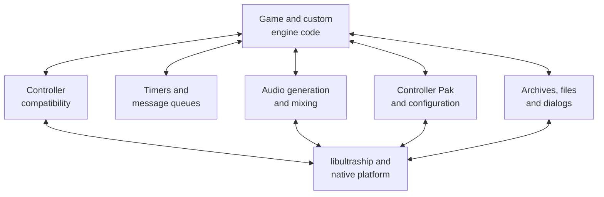
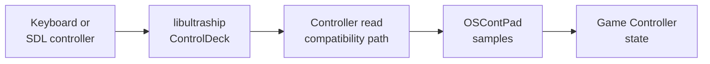
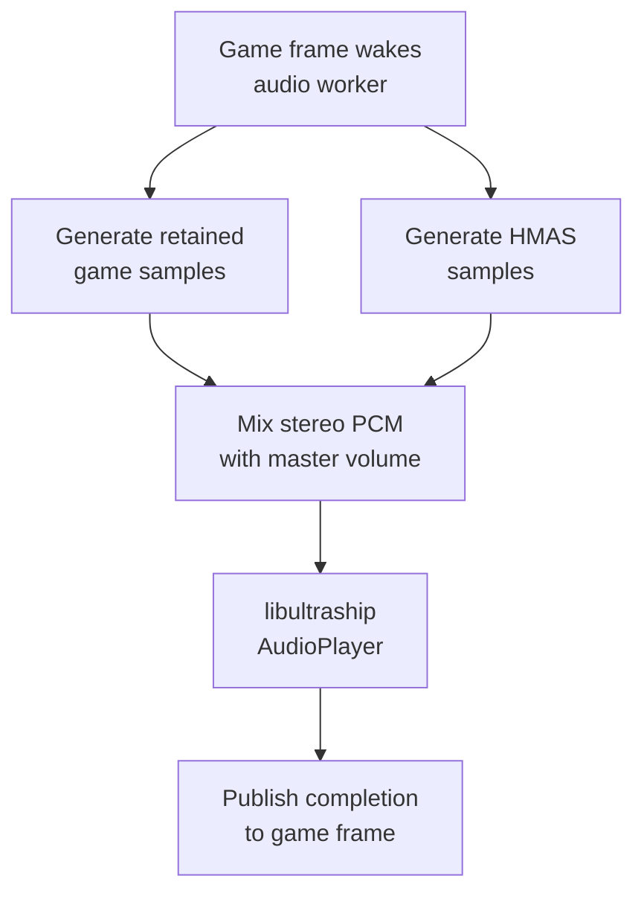
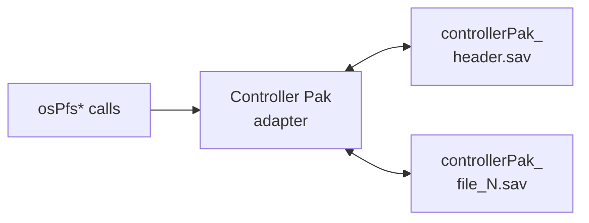

# Platform and compatibility services

## Contents

- [Responsibility](#responsibility)
- [Service map](#service-map)
- [Input](#input)
- [Timing and message APIs](#timing-and-message-apis)
- [Audio](#audio)
- [Persistent storage](#persistent-storage)
- [Configuration, files and dialogs](#configuration-files-and-dialogs)
- [Service boundaries](#service-boundaries)

Architecture path: [Overview](Overview.md) → [Runtime](Runtime.md) → **Platform and compatibility services**

## Responsibility

Services preserve the interfaces that game code expects while connecting them
to native devices and files. Some retain libultra-shaped C APIs; others are
explicit port bridges into libultraship or the operating system.

They are compatibility functions inside the native program, not a complete
emulated N64 hardware environment.

## Service map

## Input

`GameEngine` defines default native mappings and gives the resulting
`ControlDeck` to libultraship. The libultra-shaped controller path then
publishes N64 button and stick values into game-owned structures.

`read_controllers()` computes pressed, held, released, and digital stick
directions from the latest pad sample. Free-camera mode can intercept player
one before ordinary menu/race handling.

References: [default mappings](../../src/port/Engine.cpp),
[`osContStartReadData`](../../src/os/osContStartReadData.c), and
[`read_controllers`](../../src/main.c).

## Timing and message APIs

The reconstructed source retains many libultra names for queues, timers,
events, controller access, VI state, and task coordination. SpaghettiKart
compiles these C interfaces and connects the operations needed by the port to
native timing and framework behavior.

| API family | Game-visible role | Source area |
| --- | --- | --- |
| `OSMesgQueue` | Orders controller, timer, graphics, and audio notifications | [`src/os/`](../../src/os), [`main.c`](../../src/main.c) |
| `OSTimer` and `osGetTime` | Provides delays and elapsed-time calculations | [`src/os/`](../../src/os), [`Variables.cpp`](../../src/port/Variables.cpp) |
| VI functions | Retains display state and swap semantics used by game code | [`src/os/osVi*.c`](../../src/os) |
| SP/DP task functions | Retains task-facing control flow around display and audio work | [`main.c`](../../src/main.c), [`src/os/osSp*.c`](../../src/os) |

These APIs are not proof that an original N64 task runs on emulated hardware.
The graphics task ultimately reaches Fast3D, while audio reaches the native
audio worker and output device.

## Audio

Audio combines two sources per frame:

| Source | Producer | Content |
| --- | --- | --- |
| Retained game audio | `create_next_audio_buffer` | N64-style sequence, bank, and sound-effect output |
| HMAS | Native miniaudio-backed registry | Custom music, sound effects, ambience, and transitions |

Audio banks and sequences are resources loaded lazily through `GameEngine_*`
bridges. The worker uses a mutex and condition variables so the main frame does
not continue past `EndAudioFrame` until its requested buffer is complete.

References: [`HandleAudioThread`](../../src/port/Engine.cpp),
[`GameEngine_LoadBank`](../../src/port/Engine.cpp),
[`GameEngine_LoadSequence`](../../src/port/Engine.cpp), and
[`HMAS.cpp`](../../src/port/audio/HMAS.cpp).

## Persistent storage

Controller Pak calls are reimplemented over native files. A header file stores
slot metadata; each allocated slot has a corresponding data file. The API
retains operations such as initialize, allocate, find, inspect, read/write,
delete, and report free space.

Paths come from libultraship's application directory rather than the process's
arbitrary current directory. Host configuration is persisted separately in
`spaghettify.cfg.json`; resource archives and mods are separate again.

Reference: [`pak.cpp`](../../src/port/pak.cpp).

## Configuration, files and dialogs

- `Ship::Context` locates read-only packaged resources and writable
  application data across platform-specific directories.
- CVars expose settings to both the port UI and game/engine code.
- the first-run extractor uses native file selection where available, then
  validates the ROM before writing `mk64.o2r`;
- the archive manager reads O2R/ZIP/folder resources and mod metadata;
- SDL message boxes report extraction, dependency, and runtime errors.

References: [`Engine.cpp`](../../src/port/Engine.cpp),
[`GameExtractor.cpp`](../../src/port/GameExtractor.cpp), and
[Resources](Resources.md).

## Service boundaries

| Boundary | Input | Result | Observable example |
| --- | --- | --- | --- |
| Native input → game | Keyboard/gamepad state and mappings | N64-shaped controller values | Steering, braking, menus, free camera |
| Game audio → native device | Sequences, banks, effects and HMAS sources | Mixed PCM frames | Music, engines, items and ambience |
| Game storage → host files | Controller Pak operations | Durable save files | Ghost and game data persist across launches |
| Resource request → archives | O2R path and requested type | Typed native resource | Course texture, display list, audio bank |
| CVar/UI → game behavior | Persisted host setting | Branch or parameter in game/engine code | Interpolation, culling, AI and rendering options |

